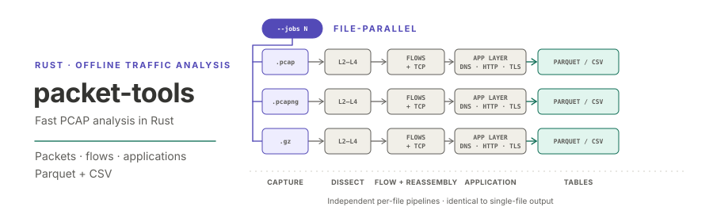

<p align="center"></p>

**English** | [日本語](README.ja.md)

# packet-tools

`packet-tools` is a Rust library and CLI for fast offline analysis of PCAP and pcapng captures. It is meant as a fast alternative to Scapy for research workloads such as intrusion-detection datasets: it extracts per-packet fields, builds bidirectional flows with configurable termination rules and flow features, reassembles IP fragments and TCP streams, parses application-layer protocols (DNS, HTTP/1.x, TLS, FTP, SSH, SMTP, Telnet), and writes the results to Parquet or CSV.

> **Status:** all features planned for the first release (milestones M0–M6) are implemented: capture reading, L2–L4 packet export, bidirectional flow tables, CICFlowMeter-compatible flow features, IP/TCP reassembly, application parsing, and file-level parallel processing. The crates are not published to crates.io yet.

## Install

The crates are not published to crates.io yet. Build from source with a recent stable Rust toolchain (1.94 or later):

```sh
git clone https://github.com/akitenkrad/rs-packet-tools.git
cd rs-packet-tools
cargo build --release
cargo run -p packet-tools -- --version
```

## Documentation

- [CLI](docs/cli.md): the `packet-tools` command, including [multiple inputs and `--jobs`](docs/cli.md#multiple-inputs)
- [Library](docs/library.md): reading and decoding captures from Rust
- [Flow columns](docs/flows-columns.md): flow schemas and CICFlowMeter name mapping
- [Application tables](docs/app-tables.md): application-layer output schemas
- [Performance](docs/performance.md): measured throughput against Scapy, end-to-end runs and parallel speed-up
- [Architecture](docs/architecture.md): crate layout, design principles and milestones
- [Development](docs/development.md): tests, synthetic fixtures, CI and benchmarks

## License

Licensed under either of [Apache License, Version 2.0](LICENSE-APACHE) or [MIT license](LICENSE-MIT) at your option. CICFlowMeter-derived behavior is covered by the [third-party notices](THIRD_PARTY_NOTICES.md).
